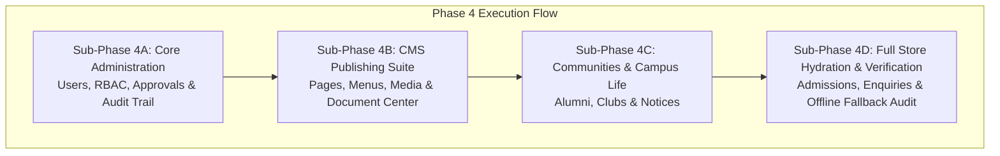

# PHASE 4 — ENTERPRISE ADMIN CMS IMPLEMENTATION PLAN
## Bishop Ambrose College (BAC) Full-Stack Application

- **Date:** 2026-11-07
- **Authoritative Specifications:** `BACKEND_API_SPECIFICATION.md`, `phase3_implementation_plan_v2point2.md`
- **Base Commit:** `ee10568` (`feat(bac): complete phase 3F integration and performance testing`)
- **Branch:** `master`
**Status:** **PROPOSED — AWAITING SUB-PHASE AUTHORIZATION**

---

## 1. Executive Summary

Phase 4 transitions the Bishop Ambrose College (BAC) administration suite (`frontend/src/components/admin/modules/`) from client-side `localStorage` (`bac_cms_*`) to the authoritative, multi-user MongoDB backend.

### Architectural Context & Completed Foundations:
- **Phase 2 (Auth & RBAC):** Implemented the hardened `User` model, bcrypt hashing, JWT issuance via HttpOnly cookies and Bearer headers, session invalidation via `tokenVersion`, brute-force lockout, and the 6-role permission system (`master_admin`, `sub_admin`, `hod`, `club_head`, `content_editor`, `staff`).
- **Phase 3D (Protected Admin CRUD & Scoping):** Implemented all 12 core administrative domains on the backend: `/api/content`, `/api/about`, `/api/departments`, `/api/courses`, `/api/events`, `/api/guest-speakers`, `/api/gallery`, `/api/news`, `/api/news/config`, `/api/iqac`, `/api/facilities`, `/api/placements`, `/api/contact`, `/api/admissions`, and `/api/contact/enquiries`.
- **Phase 3E (Frontend Integration):** Connected all public pages and standalone classic admin tabs (`contact-dashboard`, `courses-dashboard`, `facilities-dashboard`, `gallery-dashboard`, `placements-dashboard`, `admissions-tab`) via centralized `apiClient`.
- **Phase 3F (Integration & Performance Validation):** Achieved sub-100 ms p95 latency across all 7 benchmark endpoints under 20 concurrent users, passing all 15 test suites (232 tests) and production builds.

### Phase 4 Objectives:
1. Provide backend REST persistence, validation, and RBAC enforcement for the remaining enterprise CMS modules.
2. Connect `cms-store.tsx` and the corresponding administrative views to the backend, preserving seamless offline fallback capabilities.
3. Enforce strict resource scoping (`departmentId` for HODs, `clubId` for Club Heads).
4. Strictly comply with architectural boundaries:
   - **Zero Binary File Uploads:** Asset management remains strictly URL-based.
   - **Zero Live Seeding / Resets:** Production and reference files (`data/cms-database.json`) remain strictly untouched.
   - **Zero Advertisement Mutations:** Advertisement service remains in client preview mode until Phase 5.

---

## 2. Feature Gap Analysis: Completed vs. Remaining CMS Capabilities

| Domain / Module | Frontend Component | Backend API Status | Phase 4 Requirement |
| :--- | :--- | :--- | :--- |
| **Site Content & About** | `homepage-cms.tsx`, `about-manager.tsx` | Completed (`PUT /api/content`, `PUT /api/about`) | Verify full integration with `cms-store.tsx` |
| **Academic Departments** | `departments-cms.tsx`, `departments-tab.tsx` | Completed (`/api/departments` CRUD) | Verify HOD scoping in CMS view |
| **Courses & Programmes** | `courses-cms.tsx`, `courses-dashboard.tsx` | Completed (`/api/courses` CRUD) | Verify HOD scoping in CMS view |
| **Events & Speakers** | `events-cms.tsx`, `events-tab.tsx` | Completed (`/api/events`, `/api/guest-speakers`) | Verify Club Head & HOD scoping in CMS view |
| **News & Press** | `news-cms.tsx`, `news-events-manager.tsx` | Completed (`/api/news`, `/api/news/config`) | Integrated |
| **IQAC Dossiers** | `iqac-core-cms.tsx`, `iqac-manager.tsx` | Completed (`/api/iqac` CRUD & sections) | Integrated |
| **Facilities & Placements**| `facilities-cms.tsx`, `placement-cell-cms.tsx` | Completed (`/api/facilities`, `/api/placements`) | Integrated |
| **Admissions Applications**| `applications-cms.tsx`, `admissions-tab.tsx` | Completed (`GET/PUT /api/admissions`) | Connect `applications-cms.tsx` to `/api/admissions` |
| **Contact Enquiries** | `enquiries-cms.tsx`, `contact-dashboard.tsx` | Completed (`GET/PATCH /api/contact/enquiries`)| Connect `enquiries-cms.tsx` to `/api/contact/enquiries` |
| **User Administration** | `users-cms.tsx`, `roles-perms-cms.tsx` | **Missing Admin CRUD Routes** | Implement `GET/POST/PUT/DELETE /api/admin/users` |
| **Audit Log Trail** | `audit-logs-cms.tsx` | **Missing DB Collection & API** | Implement `AuditLog` model & `GET /api/admin/audit-logs` |
| **Content Approvals** | `approvals-cms.tsx` | **Missing DB Collection & API** | Implement `Approval` model & `GET/PUT /api/admin/approvals` |
| **Dynamic Page Builder** | `page-builder-cms.tsx` | **Missing DB Collection & API** | Implement `DynamicPage` model & `/api/admin/pages` CRUD |
| **Menu Builder** | `menu-builder-cms.tsx` | **Missing DB Collection & API** | Implement `NavigationMenu` model & `/api/admin/menus` |
| **Media Library (Metadata)**| `media-library-cms.tsx` | **Missing DB Collection & API** | Implement `MediaAsset` model & `/api/admin/media` |
| **Document Center** | `document-center-cms.tsx` | **Missing DB Collection & API** | Implement `CollegeDocument` model & `/api/documents` |
| **Alumni Directory** | `alumni-cms.tsx` | **Missing DB Collection & API** | Implement `Alumni` model & `/api/admin/alumni` |
| **Student Clubs** | `clubs-cms.tsx`, `associations-cms.tsx` | **Missing DB Collection & API** | Implement `Club` model & `/api/clubs` CRUD |
| **Notices & Circulars** | `notices-cms.tsx` | **Missing DB Collection & API** | Implement `Notice` model & `/api/notices` CRUD |

---

## 3. Proposed Phase 4 Sub-Phases & Roadmap

### Sub-Phase 4A: Core Administration & Governance
**Scope:**
1. **Administrative User Management:**
   - Routes: `GET /api/admin/users`, `POST /api/admin/users`, `PUT /api/admin/users/:id`, `DELETE /api/admin/users/:id`.
   - Permissions: `master_admin` exclusive for user creation/deletion; `sub_admin` restricted from altering `master_admin` accounts.
   - Guardrails: Self-deletion prevention, password hashing with bcrypt, normalization.
2. **Centralized Audit Logging:**
   - Model: `AuditLog` (`userId`, `userName`, `userRole`, `action`, `module`, `recordId`, `recordTitle`, `oldValue`, `newValue`, `timestamp`, `ipAddress`).
   - Routes: `GET /api/admin/audit-logs` (filterable by module, user, date).
   - Hook: Utility `recordAuditLog()` integrated with administrative mutations.
3. **Approvals Workflow:**
   - Model: `Approval` (`entityType`, `entityId`, `title`, `departmentId`, `clubId`, `authorId`, `status`, `rejectionReason`, `submittedAt`, `reviewedAt`, `reviewerId`).
   - Routes: `GET /api/admin/approvals`, `PUT /api/admin/approvals/:id` (approve/reject with reviewer tracking and department/club scoping).
4. **Frontend Integration:**
   - Connect `users-cms.tsx`, `roles-perms-cms.tsx`, `audit-logs-cms.tsx`, and `approvals-cms.tsx` via `apiClient`.
   - Synchronize `currentUser` in `cms-store.tsx` with `/api/auth/me`.

### Sub-Phase 4B: CMS Publishing Suite (Pages, Menus, Media & Document Center)
**Scope:**
1. **Dynamic Page Builder:**
   - Model: `DynamicPage` (`title`, `slug`, `parentMenuId`, `pageType`, `description`, `bannerImage`, `blocks`, `seo`, `status`, `departmentId`, `clubId`).
   - Routes: `GET /api/admin/pages`, `POST /api/admin/pages`, `PUT /api/admin/pages/:id`, `DELETE /api/admin/pages/:id`.
2. **Navigation Menu Builder:**
   - Model: `NavigationMenu` (`label`, `path`, `icon`, `order`, `parentId`, `target`, `isCustom`, `visible`, `pageId`).
   - Routes: `GET /api/admin/menus`, `PUT /api/admin/menus`.
3. **Media Library Metadata (URL-Based):**
   - Model: `MediaAsset` (`title`, `fileName`, `fileType`, `mimeType`, `size`, `url`, `category`, `tags`, `uploadedBy`, `uploadedAt`, `altText`).
   - Routes: `GET /api/admin/media`, `POST /api/admin/media`, `DELETE /api/admin/media/:id`.
   - Strictly URL-based assets; zero multipart file upload.
4. **Institutional Document Center:**
   - Model: `CollegeDocument` (`title`, `category`, `departmentId`, `fileSize`, `fileFormat`, `fileUrl`, `uploadedBy`, `status`, `year`, `downloadCount`, `isPublic`).
   - Routes: `GET /api/documents`, `POST /api/documents`, `DELETE /api/documents/:id`.
5. **Frontend Integration:**
   - Connect `page-builder-cms.tsx`, `menu-builder-cms.tsx`, `media-library-cms.tsx`, and `document-center-cms.tsx`.

### Sub-Phase 4C: Institutional Communities & Student Life (Alumni, Clubs & Notices)
**Scope:**
1. **Alumni Network & Directory:**
   - Model: `Alumni` (`name`, `batch`, `degree`, `departmentSlug`, `company`, `role`, `location`, `linkedin`, `email`, `phone`, `verified`, `avatar`).
   - Routes: `POST /api/alumni/register` (public), `GET /api/admin/alumni`, `PUT /api/admin/alumni/:id/verify`.
2. **Student Clubs & Associations:**
   - Model: `Club` (`name`, `slug`, `category`, `description`, `leadName`, `leadEmail`, `leadPhone`, `bannerImage`, `eventsCount`, `membersCount`, `featured`, `isActive`).
   - Routes: `GET /api/clubs`, `POST /api/clubs`, `PUT /api/clubs/:id`, `DELETE /api/clubs/:id` (with club_head scoping).
3. **Official Notices & Circulars:**
   - Model: `Notice` (`title`, `category`, `date`, `departmentId`, `fileUrl`, `isPinned`, `isImportant`, `status`).
   - Routes: `GET /api/notices`, `POST /api/notices`, `PUT /api/notices/:id`, `DELETE /api/notices/:id`.
4. **Frontend Integration:**
   - Connect `alumni-cms.tsx`, `clubs-cms.tsx`, `associations-cms.tsx`, and `notices-cms.tsx`.

### Sub-Phase 4D: Admissions & Enquiries CMS Integration & State Hydration
**Scope:**
1. **Admissions & Enquiries CMS Wiring:**
   - Connect `applications-cms.tsx` to existing `GET /api/admissions` and `PUT /api/admissions/:id` endpoints from Phase 3D.
   - Connect `enquiries-cms.tsx` to existing `GET /api/contact/enquiries` and `PATCH /api/contact/enquiries/:id/status` endpoints from Phase 3D.
2. **`cms-store.tsx` Hydration & Fallback:**
   - Replace synchronous `localStorage` initial state with asynchronous initial fetch from backend APIs.
   - Fall back to `localStorage` or initial defaults if backend request fails (offline preservation).
   - Real-time updates to backend APIs on mutations.
3. **Full System Verification:**
   - Complete regression testing, build verification, and performance spot-check.

---

## 4. Security & Architecture Guardrails

1. **Authentication:** All administrative routes enforce `requireAuth` checking HttpOnly cookie and Bearer tokens.
2. **Authorization (RBAC):** Every route requires explicit granular permissions (e.g. `users:manage`, `audit:read`, `approvals:manage`, `pages:manage`, `documents:manage`).
3. **Resource Scoping:** HODs remain strictly scoped to their `departmentId`; Club Heads remain strictly scoped to their `clubId`.
4. **Zero Live Database Mutations:** Benchmark and unit tests use isolated test databases (`bac_test_integration_phase3f` or MongoDB memory server). No live college database is modified.
5. **No Binary Uploads:** Asset management remains strictly URL-based until explicit approval for file uploads.
6. **No Advertisement Mutations:** Advertisements module remains in client-side preview mode until Phase 5.

---

## 5. Acceptance Criteria per Sub-Phase

- **Sub-Phase 4A Acceptance:** Users CRUD, Audit Logs, and Approvals endpoints fully tested and passing; unit test suite added; `users-cms.tsx` and `audit-logs-cms.tsx` integrated; ESLint and builds clean.
- **Sub-Phase 4B Acceptance:** Pages, Menus, Media, and Documents models and CRUD endpoints tested; `page-builder-cms.tsx` and `document-center-cms.tsx` integrated; builds clean.
- **Sub-Phase 4C Acceptance:** Alumni, Clubs, and Notices endpoints tested; `alumni-cms.tsx` and `clubs-cms.tsx` integrated; builds clean.
- **Sub-Phase 4D Acceptance:** Applications and Enquiries integrated in CMS views; full `cms-store.tsx` asynchronous hydration with offline fallback verified; complete 100% test pass across all backend suites.

---

## 6. Approval Gate

In accordance with project rules:
- Work will proceed in small, testable sub-phases starting with **Sub-Phase 4A**.
- After each sub-phase is implemented and tested, a report will be presented to await your explicit approval before committing and pushing.
